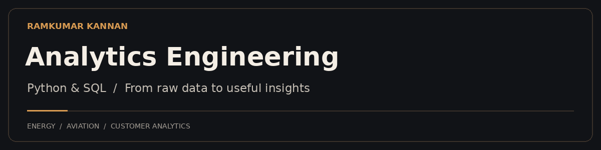

### Analytics Engineering · Data Engineering · Business Intelligence

**Turning raw data into clear metrics and practical decisions.**

MSc Data Engineering for AI @ DSTI · Sophia Antipolis, France

[Tech Stack](#tech-stack) · [Projects](#featured-projects) · [Education](#education)

---

## Hi, I'm Ramkumar

I work with **Python, SQL, and business intelligence tools** to collect, prepare, and analyze data. With a background in industrial operations and business analytics, I'm building my career in **analytics engineering**—connecting reliable data pipelines to the questions that matter to a business.

**Seeking analytics engineering and data engineering internships.**

## Tech Stack

<table>
<tr><td width="25%"><b>Data &amp; Analytics</b></td><td><code>Python</code> · <code>SQL</code> · <code>pandas</code> · <code>NumPy</code> · <code>EDA</code> · <code>Feature Engineering</code></td></tr>
<tr><td><b>Data Engineering</b></td><td><code>API Integration</code> · <code>Data Ingestion</code> · <code>ETL Pipelines</code> · <code>JSON / CSV</code> · <code>Data Cleaning</code></td></tr>
<tr><td><b>Databases</b></td><td><code>PostgreSQL</code> · <code>MySQL</code> · <code>SQL Server</code> · <code>MongoDB</code> · <code>SQLite</code></td></tr>
<tr><td><b>BI &amp; Visualization</b></td><td><code>Power BI</code> · <code>DAX</code> · <code>Excel</code> · <code>Streamlit</code> · <code>Plotly</code> · <code>Matplotlib</code></td></tr>
<tr><td><b>Machine Learning</b></td><td><code>scikit-learn</code> · <code>XGBoost</code> · <code>Time-Series Forecasting</code> · <code>Model Evaluation</code></td></tr>
<tr><td><b>Development Tools</b></td><td><code>Git</code> · <code>GitHub</code> · <code>Jupyter</code> · <code>VS Code</code> · <code>FastAPI</code> · <code>Flask</code></td></tr>
<tr><td><b>Currently Learning</b></td><td><code>dbt</code> · <code>Dimensional Modeling</code> · <code>Automated Data Testing</code></td></tr>
</table>

**SQL focus:** joins, CTEs, window functions, and business metrics.  
**Data-quality focus:** missing values, duplicate records, inconsistent timestamps, and field normalization.

## Featured Projects

### 01 / [Customer Churn & Retention Analytics](https://github.com/klt-ramkumar/nimbus-churn-analysis)
Combined PostgreSQL customer data with MongoDB product events in an analytics challenge. Cleaned inconsistent data, investigated onboarding and churn, and built customer risk segments with an interactive dashboard.

**PostgreSQL · MongoDB · Python · Statistical Analysis · Chart.js**

### 02 / [Smart EV Charging Scheduler](https://github.com/klt-ramkumar/Smart-EV-Charging)
Built a Streamlit prototype using Octopus Agile tariffs and UK Carbon Intensity data to compare charging costs, identify lower-cost windows, and visualize energy information.

**Python · REST APIs · Streamlit · Plotly · XGBoost**

### 03 / Flight Analytics Pipeline · In Progress
Developing a departure-data pipeline for Nice Côte d'Azur Airport, from AirLabs API ingestion to PostgreSQL storage and an airport-style dashboard.

- **Built:** Python collector, raw data storage, CSV exports, scheduled local collection, and departure-board display.
- **Improving:** collection reliability.
- **Next:** dbt transformations for deduplication, code-share handling, and updated flight statuses; departure and delay metrics.

**Python · AirLabs API · PostgreSQL · Windows Task Scheduler**

<b>More energy analytics projects</b>

- **[Electricity Market Anomaly Detection](https://github.com/klt-ramkumar/anomaly-detection-electricity-dk)** — Prepared Danish DK1 price data and applied rolling statistics and z-score rules to flag unusual movements.
- **[Energy Consumption Forecasting](https://github.com/klt-ramkumar/ML-ON-ENERGY-DATASET)** — AEP hourly demand forecasting with temporal features and XGBoost. Learning project developed with guidance from Rob Mulla's tutorials.

## Education

**MSc Data Engineering for AI** · DSTI, Sophia Antipolis · In progress  
**MSc Business Analytics & Consultancy** · Heriot-Watt University, Edinburgh  
**B.E. Chemical Engineering**

---

**Energy · Aviation · Customer Analytics**

Curious about the data. Focused on the decision.

[Explore my repositories →](https://github.com/klt-ramkumar?tab=repositories)

